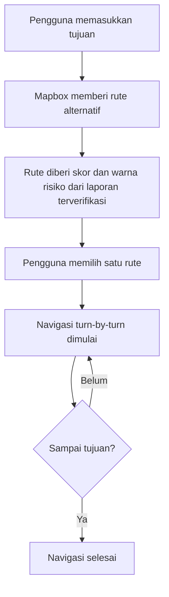
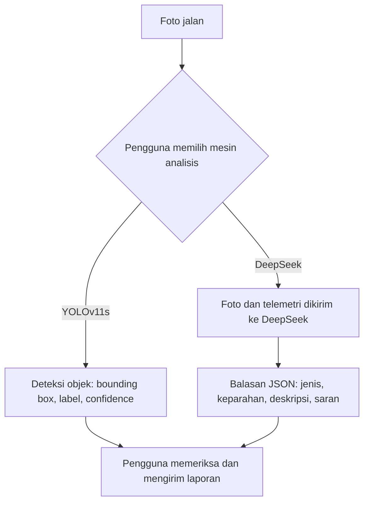
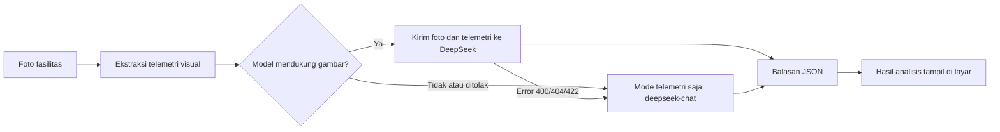
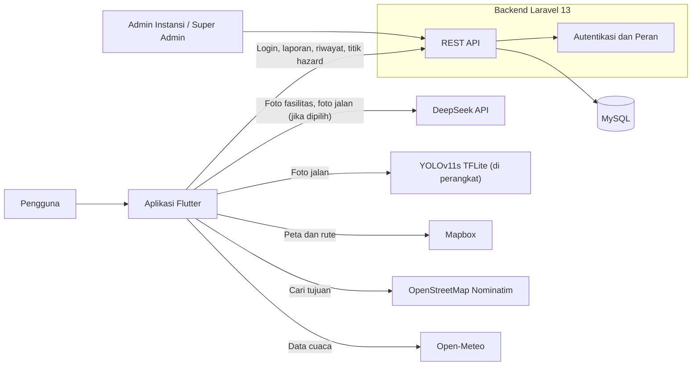
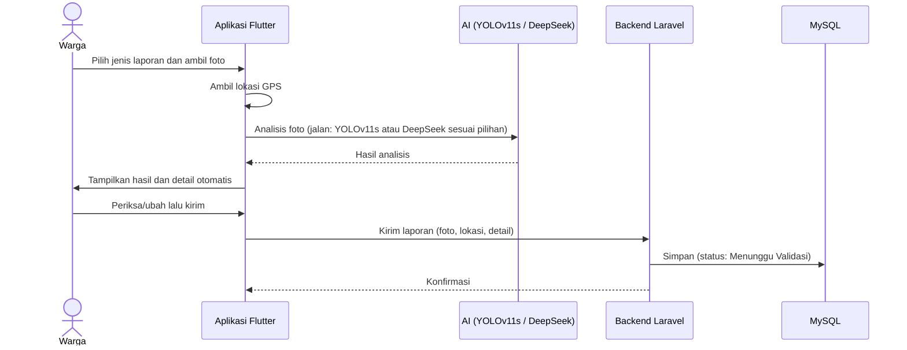
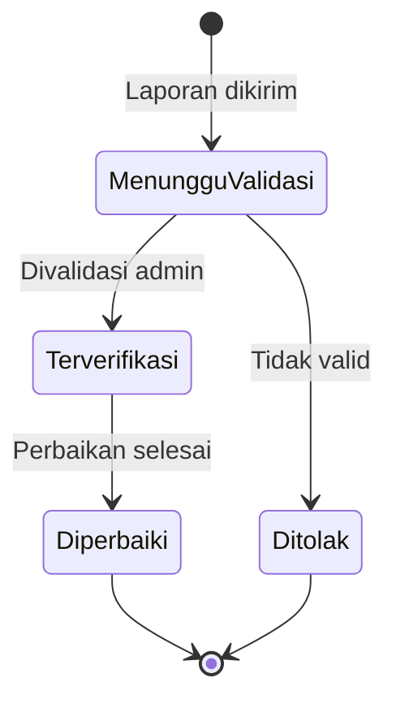
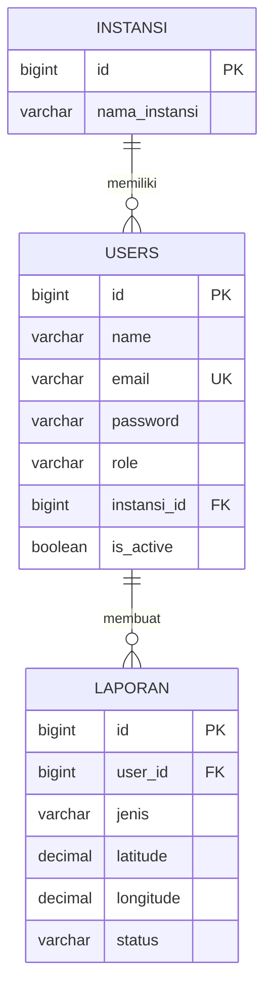

<h1 align="center">LaporDermayu</h1>

<p align="center">
  <b>Aplikasi pelaporan jalan &amp; fasilitas rusak berbasis AI, dilengkapi navigasi rute aman untuk Kabupaten Indramayu</b><br>
  <i>Laporkan kerusakannya, Kawal perbaikannya!</i>
</p>

<p align="center">
  
</p>

<p align="center">
  
  
  
</p>

<p align="center">
  
  
  
  
  
  
  
  
</p>

---

## 📑 Daftar Isi

- [Tentang Proyek](#-tentang-proyek)
- [Latar Belakang](#-latar-belakang)
- [Masalah & Solusi](#-masalah--solusi)
- [Tim](#-tim)
- [Fitur Utama](#-fitur-utama)
- [Cara Kerja Navigasi Rute Aman](#-cara-kerja-navigasi-rute-aman)
- [Cara Kerja Analisis AI](#-cara-kerja-analisis-ai)
- [Teknologi](#-teknologi)
- [Arsitektur Sistem](#-arsitektur-sistem)
- [Alur Data](#-alur-data)
- [Peran Pengguna](#-peran-pengguna-rbac)
- [Struktur Database](#-struktur-database)
- [Instalasi & Menjalankan](#-instalasi-konfigurasi--menjalankan-aplikasi)
- [Akun Demonstrasi](#-akun-demonstrasi)
- [Dokumentasi Penggunaan AI](#-dokumentasi-penggunaan-ai)
- [Etika, Privasi & Keamanan](#-etika-privasi--keamanan)
- [Nilai Tambah & Dampak](#-nilai-tambah--dampak)
- [Kesesuaian dengan Kriteria Penilaian](#-kesesuaian-dengan-kriteria-penilaian)
- [Atribusi](#-atribusi-pihak-ketiga)
- [Tautan Submission](#-tautan-submission)

---

## 🌟 Tentang Proyek

**LaporDermayu** menghubungkan warga Indramayu dengan layanan publik. Warga memotret jalan atau fasilitas yang rusak, AI membantu menganalisis foto, dan laporan tercatat lengkap dengan lokasi serta bukti. Status laporan bisa dipantau sampai selesai diperbaiki.

Aplikasi juga berfungsi seperti **navigasi turn-by-turn**: dengan petunjuk suara, pengguna memilih salah satu rute alternatif, lalu dipandu sampai tujuan. Setiap rute diberi warna sesuai tingkat risikonya (hijau, oranye, merah) berdasarkan laporan warga yang sudah diverifikasi.

Tujuan utamanya: **membuat jalan di Indramayu lebih aman, terutama bagi pengendara yang melintas pagi hari, siang hari maupun malam hari.**

---

## 📖 Latar Belakang

Jalan adalah urat nadi aktivitas warga Indramayu: berangkat kerja, sekolah, mengangkut hasil pertanian, sampai pulang larut malam. Kondisi di lapangan sering tidak aman:

- **Jalan berlubang di banyak ruas.** Lubang sulit terlihat saat hujan (tergenang) atau malam hari, sehingga pengendara mudah terjatuh.
- **Jalan gelap tanpa penerangan memadai.** Selain menyulitkan melihat lubang, ruas yang gelap menimbulkan rasa tidak aman bagi pengendara yang pulang malam.
- **Fasilitas umum rusak.** Lampu penerangan jalan yang mati, rambu rusak, dan fasilitas lain memperburuk kondisi tersebut, dan sering baru ditangani lama setelah rusak.
- **Tidak ada kanal yang mudah** untuk melapor dan melacak tindak lanjut, serta **tidak ada informasi** untuk memilih jalan yang lebih aman sebelum berangkat.

> Selama ini warga hanya bisa "berhati-hati". **LaporDermayu mengubahnya menjadi aksi:** melapor dengan mudah, dibantu AI, dan dipandu rute yang lebih aman.

**Pertanyaan yang dijawab LaporDermayu:**

1. Bagaimana warga melaporkan jalan atau fasilitas rusak dengan cepat dan disertai bukti yang jelas?
2. Bagaimana warga memantau apakah laporannya benar-benar ditindaklanjuti?
3. Bagaimana pengendara memilih rute yang lebih aman, terutama saat malam hari?

---

## 🔎 Masalah & Solusi

| # | Masalah | Solusi LaporDermayu |
|---|---|---|
| 1 | Jalan berlubang sulit dilihat (hujan/malam), memicu kecelakaan | Deteksi kerusakan jalan dengan AI dari foto (pengguna memilih YOLOv11s atau DeepSeek), titik tampil di peta, navigasi menandai rute berisiko |
| 2 | Jalan gelap dan lampu penerangan mati | Laporan fasilitas penerangan dianalisis AI (DeepSeek) dan dilaporkan ke instansi |
| 3 | Kanal pelaporan tidak mudah dan tidak terstruktur | Lapor dalam beberapa ketukan: foto → analisis AI → kirim |
| 4 | Laporan tanpa bukti, lokasi, dan tingkat kerusakan | Foto, GPS otomatis, tingkat keparahan dari AI, detail laporan terisi otomatis |
| 5 | Warga tidak bisa melacak tindak lanjut | Status laporan, riwayat, dan ringkasan *Dampak Nyata* |

### 📍 Cakupan Wilayah

LaporDermayu dirancang khusus untuk Kabupaten Indramayu. Batas wilayah kabupaten disimpan sebagai berkas GeoJSON di backend/resources/indramayu.geojson dan dipakai backend untuk memastikan lokasi laporan berada di dalam Indramayu. Latar belakang masalah, laporan, dan penilaian rute juga berfokus di wilayah ini.

### 🎯 Target Pengguna

- **Masyarakat Indramayu** yang ingin melapor dan memilih rute aman
- **Pengendara** yang sering melintas pagi, siang, malam hari
- **Admin Instansi (Pemda Indramayu)** yang memverifikasi dan menindaklanjuti laporan

---

## 👥 Tim

| Peran | Nama | GitHub |
|---|---|---|
| Ketua Tim | `Faldy Ardiansyah` | https://github.com/faldyardiansyah |
| Anggota | `Wildan Firdaus` | https://github.com/WILDAAN313 |
| Anggota | `Rakha Rasya Setiawan` | https://github.com/Vliocre |
| Anggota | `Arizal Yudistira As-safiq` | https://github.com/arizalassyafiq-arch |

**Nama tim:** `Nama timnya apa?` · **Instansi:** `Politeknik Negeri Indramayu`

> Seluruh commit dibuat dari akun GitHub anggota yang terdaftar di LOGICODIX 2026.

---

## ✨ Fitur Utama

### 📸 Pelaporan Berbantuan AI

| Fitur | Deskripsi |
|---|---|
| **Lapor Jalan Rusak** | Pengguna memilih mesin analisis di layar lapor. **YOLOv11s** (TFLite, berjalan langsung di HP tanpa internet) mendeteksi 7 jenis kerusakan jalan lengkap dengan bounding box dan persentase keyakinan. **DeepSeek** juga dapat dipilih untuk mendeteksi kerusakan jalan dan menghasilkan jenis kerusakan, tingkat keparahan, deskripsi, dan saran. |
| **Lapor Fasilitas Umum** | Foto Lampu PJU, rambu, traffic light, halte, marka, atau guardrail dianalisis **DeepSeek** menjadi jenis fasilitas, kondisi, tingkat keparahan, deskripsi, dan saran tindak lanjut. |
| **Detail Laporan Otomatis** | Judul dan deskripsi terisi dari hasil AI dan tetap bisa diedit sebelum dikirim. |
| **Lokasi Otomatis** | Koordinat GPS dilampirkan ke setiap laporan. |

### 🛠️ Objek yang Dapat Dilaporkan

**Fasilitas umum** (dianalisis DeepSeek):

| Fasilitas | Contoh kondisi yang dikenali |
|---|---|
| Lampu Penerangan Jalan Umum (PJU) | mati, rusak, roboh, miring |
| Rambu lalu lintas | rusak, miring, hilang, tertutup (mis. ranting pohon) |
| Traffic light (lampu lalu lintas) | mati, rusak |
| Halte | rusak, tertutup stiker liar |
| Marka dan pembatas jalan | pudar, rusak |
| Guardrail | rusak, roboh, miring |

Kondisi yang dapat dihasilkan AI: `mati`, `rusak`, `roboh`, `miring`, `hilang`, `tertutup`, `normal`. Tingkat keparahan: `ringan`, `sedang`, `berat`.

**Jalan rusak** (dianalisis YOLOv11s atau DeepSeek):

| Jenis kerusakan | Kelas model YOLOv11s | YOLOv11s | DeepSeek |
|---|---|---|---|
| Lubang | `pothole` | ✔ | ✔ |
| Retak kulit buaya | `alligator cracking` | ✔ | ✔ (sebagai retak) |
| Retak tepi | `edge cracking` | ✔ | ✔ (sebagai retak) |
| Retak memanjang | `longitudinal cracking` | ✔ | ✔ (sebagai retak) |
| Retak melintang | `transverse cracking` | ✔ | ✔ (sebagai retak) |
| Tambalan | `patching` | ✔ | – |
| Alur bekas roda | `rutting` | ✔ | – |
| Amblas, bergelombang, aspal terkelupas, genangan | – | – | ✔ |

### 🧭 Navigasi Rute Aman

| Fitur | Deskripsi |
|---|---|
| **Rute Alternatif Berwarna Risiko** | Pengguna melihat rute alternatif dari Mapbox. Warna menunjukkan risiko: **hijau** (aman/rendah), **oranye** (sedang), **merah** (tinggi), **merah tua** (sangat tinggi, malam hari). |
| **Navigasi Turn-by-Turn** | Pengguna dipandu langkah demi langkah dengan petunjuk suara berbahasa Indonesia (pengumuman bertahap: jauh, menengah, dekat) dan peringatan lubang atau jalan gelap di depan. |
| **Rute Terkunci** | Rute tidak bisa diganti di tengah perjalanan. Jika pengguna keluar jalur, rute baru dihitung otomatis dari posisi saat ini. |
| **Peta & Pencarian Tujuan** | Peta interaktif (`flutter_map`), rute dari Mapbox Directions, pencarian tujuan lewat OpenStreetMap Nominatim, dan lokasi pengguna lewat GPS. |
| **Info Cuaca & Peringatan** | Data cuaca dari **Open-Meteo**: suhu, kondisi cuaca, kelembapan, angin, dan peringatan seperti genangan atau jalan licin. |

### 📊 Pemantauan & Pengelolaan

| Fitur | Deskripsi |
|---|---|
| **Dampak Nyata** | Jumlah laporan: dikirim, terverifikasi, diperbaiki. |
| **Laporan Terkini & Riwayat** | Status laporan, misalnya *Menunggu Validasi*. |
| **Akses Berbasis Peran** | Tiga peran: Masyarakat, Admin Instansi, dan Super Admin. |
| **Dashboard Pengelolaan** | `[ISI: jelaskan panel web/admin untuk memverifikasi laporan dan memperbarui status, atau hapus baris ini jika belum ada]` |

---

## 🧭 Cara Kerja Navigasi Rute Aman



- Pengguna memilih **satu rute** dan dipandu sampai tujuan. Setelah dipilih, rute **terkunci** sampai navigasi selesai atau dibatalkan.
- Skor risiko dihitung dari **laporan warga berstatus terverifikasi, diproses, diperbaiki, atau selesai** (diambil dari endpoint `/laporan-peta`, diperbarui tiap 60 detik) yang berada **dalam 30 meter** dari rute.
- Bobot laporan kerusakan jalan: lubang/jalan rusak berat = 5, sedang = 3, ringan = 2 (genangan/banjir 3 atau 5). Laporan penerangan buruk berbobot **5 pada malam hari** (18.00–06.00 WIB) dan 0,5 pada siang hari. Jika rute punya kerusakan sekaligus penerangan buruk, ada tambahan skor (3 malam, 0,5 siang).

| Total skor | Label | Warna |
|---|---|---|
| 0 | Aman, tidak ada kendala | Hijau |
| di bawah 3 | Risiko rendah | Hijau |
| 3 sampai di bawah 8 | Risiko sedang | Oranye |
| 8 atau lebih | Risiko tinggi | Merah |
| 12 atau lebih (malam) | Risiko sangat tinggi | Merah tua |

- Estimasi waktu tiba memakai asumsi kecepatan minimal 25 km/jam, bukan data lalu lintas langsung.

> **Catatan:** rute aman adalah *rekomendasi*, bukan jaminan keselamatan. Aplikasi tidak melabeli wilayah sebagai "daerah kriminal"; yang dinilai adalah kondisi fisik jalan.

---

## 🤖 Cara Kerja Analisis AI

Aplikasi memakai dua model AI. Semua pemanggilan DeepSeek dilakukan oleh `DeepSeekService` di aplikasi Flutter. YOLOv11s berjalan langsung di HP dalam format TFLite (`tflite_flutter`), sehingga deteksi jalan rusak dengan YOLO tidak membutuhkan internet maupun server AI.

| Jenis laporan | Mesin analisis | Cara dipilih |
|---|---|---|
| **Jalan rusak** | YOLOv11s | Pilihan di layar lapor jalan |
| **Jalan rusak** | DeepSeek (`analyzeRoadImage`) | Pilihan di layar lapor jalan |
| **Fasilitas umum** | DeepSeek (`analyzeImage`) | Otomatis untuk setiap laporan fasilitas |

### A. Alur Lapor Jalan Rusak (YOLOv11s atau DeepSeek)



| Aspek | YOLOv11s | DeepSeek |
|---|---|---|
| Keluaran | Bounding box, label, persentase keyakinan | Jenis kerusakan, keparahan, deskripsi, saran (teks) |
| Visualisasi di foto | Ada | Tidak ada bounding box |
| Koneksi internet | Tidak diperlukan (berjalan di perangkat) | Wajib |
| Cocok untuk | Deteksi lubang yang cepat dan terukur | Penilaian kerusakan beragam dan penjelasan dalam bahasa Indonesia |

- Analisis jalan oleh DeepSeek **wajib memakai foto**. Statistik kecerahan tidak bisa menunjukkan lubang, jadi tidak ada mode telemetri untuk jalan. Jika layanan menolak gambar, aplikasi menampilkan pesan bahwa analisis AI tidak tersedia dan pengguna tetap bisa memakai YOLOv11s atau melapor manual.
- Hasil DeepSeek berupa perkiraan dari model bahasa-visual, sehingga pengguna dapat mengoreksinya sebelum dikirim.

### B. Alur Lapor Fasilitas Umum (DeepSeek)



**Telemetri visual** dihitung langsung di perangkat dari foto, lalu dikirim sebagai konteks tambahan:

| Data | Kegunaan |
|---|---|
| Waktu pengambilan (siang/malam) | Membedakan lampu padam saat malam dengan kondisi wajar di siang hari |
| Rata-rata kecerahan (luminance, 0–255) | Menilai tingkat penerangan |
| Persentase area gelap | Menilai seberapa gelap ruas jalan |
| Persentase titik cahaya kuat | Menilai apakah ada lampu yang menyala |
| Resolusi foto | Informasi teknis |

Pada mode fallback (telemetri saja), AI tidak menerima fotonya, hanya statistik kecerahan dan waktu, sehingga hasilnya berupa perkiraan yang dapat dikoreksi pengguna.

### C. Format Keluaran (JSON wajib)

Kedua jalur memakai struktur JSON yang sama.

| Field | Fasilitas umum | Jalan rusak (DeepSeek) |
|---|---|---|
| `fasilitas_umum` | Objek termasuk fasilitas jalan | `true` jika ada kerusakan jalan terlihat |
| `jenis_fasilitas` | Mis. Lampu Penerangan Jalan (PJU), Rambu Lalu Lintas | Mis. Jalan Berlubang, Jalan Retak, Jalan Amblas, Genangan di Jalan |
| `kondisi` | `mati`, `rusak`, `roboh`, `miring`, `hilang`, `tertutup`, `normal` | `berlubang`, `retak`, `amblas`, `bergelombang`, `tergenang`, `normal` |
| `tingkat_keparahan` | `ringan`, `sedang`, `berat` | `ringan`, `sedang`, `berat` |
| `deskripsi` | Penjelasan 1–2 kalimat berbahasa Indonesia | Penjelasan 1–2 kalimat berbahasa Indonesia |
| `saran` | Saran tindak lanjut untuk petugas | Saran tindak lanjut untuk petugas |

### D. Prompt AI

Prompt lengkap ada di `lapordermayu/lib/services/deepseek_service.dart'. Ringkasannya:

**Prompt fasilitas umum** (`_facilityPrompt`)
- Peran: sistem AI analisis fasilitas jalan untuk LaporDermayu.
- Masukan: foto fasilitas + telemetri visual. Keluaran: JSON saja.
- Aturan keparahan: *berat* untuk bahaya langsung (traffic light mati, tiang roboh melintang, rambu tikungan tajam hilang), *sedang* untuk PJU mati di jalan utama atau rambu miring/tertutup, *ringan* untuk marka pudar atau stiker liar.
- Menyertakan satu contoh jawaban ideal (PJU mati malam hari).

**Prompt jalan rusak** (`_roadPrompt`)
- Peran: sistem AI analisis kerusakan jalan, dipakai ketika pengguna memilih DeepSeek sebagai mesin analisis.
- Aturan anti-halusinasi: menilai hanya yang benar-benar terlihat, tidak menebak. Jika foto bukan jalan atau jalan baik, jawab `fasilitas_umum: false` dan `kondisi: "normal"`. Tidak menyebut identitas, wajah, atau plat nomor.
- Aturan keparahan: *berat* untuk lubang dalam/lebar di jalur utama atau amblas, *sedang* untuk lubang kecil-menengah, retak panjang, atau genangan yang diduga menutupi lubang, *ringan* untuk retak halus atau aspal terkelupas.
- Menyertakan satu contoh jawaban ideal (jalan berlubang, berat).

### E. Penanganan Error

Kunci tidak valid (401), kuota habis (402), server sibuk (429), batas waktu 40 detik, dan fallback otomatis ke mode telemetri jika endpoint menolak gambar (khusus analisis fasilitas).

---

## 🧰 Teknologi

| Lapisan | Teknologi |
|---|---|
| **Mobile** (`/lapordermayu`) | Flutter (Dart SDK `^3.9.0`) |
| **Backend** (`/backend`) | Laravel 13 (PHP sesuai `composer.json`) |
| **Database** | MySQL |
| **Peta & Rute** | Mapbox Directions API (rute dan instruksi belok), `flutter_map` + `latlong2` (tampilan peta) |
| **Pencarian Tujuan** | OpenStreetMap Nominatim |
| **GPS & Suara** | `geolocator` (lokasi), `flutter_tts` (petunjuk suara bahasa Indonesia) |
| **AI Fasilitas & Jalan Rusak** | DeepSeek (model dari `DEEPSEEK_MODEL`, bawaan `deepseek-flash`; cadangan `deepseek-chat` untuk analisis fasilitas) |
| **AI Jalan Rusak** | YOLOv11s format TFLite (`tflite_flutter`), dijalankan di perangkat; model ada di `assets/model/` |
| **Cuaca** | Open-Meteo (tanpa API key) |
| **Library Flutter** | `get`, `get_storage`, `dio`, `http`, `flutter_dotenv`, `flutter_map`, `latlong2`, `geolocator`, `flutter_tts`, `tflite_flutter`, `camera`, `image`, `flutter_image_compress`, `photo_view`, `lottie`, `flutter_animate`, `google_fonts`, `awesome_snackbar_content`, `skeletonizer` |

---

## 🏗️ Arsitektur Sistem



> YOLOv11s berjalan di dalam aplikasi lewat TFLite, tanpa server. Hanya DeepSeek, Mapbox, Nominatim, dan Open-Meteo yang membutuhkan internet.

---

## 🔄 Alur Data

### Alur Pelaporan



### Siklus Status Laporan




---

## 🔐 Peran Pengguna (RBAC)

| Peran | Kode | Hak Akses |
|---|---|---|
| **Masyarakat** | `masyarakat` | Melapor, navigasi rute aman, memantau riwayat dan dampak |
| **Admin Instansi** | `admin_instansi` | Terkait instansi (Pemda Indramayu): memverifikasi dan menindaklanjuti laporan `[ISI]` |
| **Super Admin** | `super_admin` | Akses penuh, pengelolaan pengguna dan instansi `[ISI]` |

Akun memiliki penanda aktif/nonaktif (`is_active`).

---

## 🗄️ Struktur Database

MySQL dengan migrasi Laravel di `backend/database/migrations`.



---

## 🚀 Instalasi, Konfigurasi & Menjalankan Aplikasi

### Struktur Repositori

```
LaporDermayu/
├── backend/          # Laravel 13 (REST API + MySQL)
├── lapordermayu/     # Aplikasi Flutter (model TFLite di assets/model/)
├── assets/           # Gambar README
└── README.md
```

### Prasyarat

| Kebutuhan | Keterangan |
|---|---|
| Git | - |
| PHP & Composer | Versi sesuai `backend/composer.json` (Laravel 13) |
| MySQL | `[ISI: versi]` |
| Flutter SDK | Stable terbaru (Dart `^3.9.0`) |
| Android Studio / emulator / perangkat Android | Untuk menjalankan aplikasi |
| Akun DeepSeek (API key) | https://platform.deepseek.com |
| Akun Mapbox (access token) | https://account.mapbox.com |

> Open-Meteo tidak membutuhkan akun atau API key.

### 1) Clone

```bash
git clone https://github.com/faldyardiansyah/LaporDermayu.git
cd LaporDermayu
```

### 2) Backend (Laravel 13)

```bash
cd backend
composer install
cp .env.example .env
php artisan key:generate
```

Buat database MySQL kosong, lalu isi koneksi di `backend/.env`:

```dotenv
DB_CONNECTION=mysql
DB_HOST=127.0.0.1
DB_PORT=3306
DB_DATABASE=nama_database
DB_USERNAME=root
DB_PASSWORD=
```

Jalankan migrasi, seeder, dan server:

```bash
php artisan migrate
php artisan db:seed
php artisan serve --host=0.0.0.0 --port=8000
```

> ⚠️ `DatabaseSeeder` membutuhkan instansi **"Pemda Indramayu"** sudah ada di tabel `instansi`. Jika belum ada, seeder dibatalkan tanpa mengubah data. `[ISI: jelaskan instansi itu dibuat oleh migrasi atau seeder lain, dan pastikan urutan perintah di atas sudah benar]`

### 3) Aplikasi Flutter

```bash
cd lapordermayu
cp .env.example .env
flutter pub get
```

Salin `.env.example` menjadi `.env` (di Windows CMD: `copy .env.example .env`), lalu isi nilainya sendiri. File `.env` tidak ikut di-clone karena masuk `.gitignore`:

```dotenv
DEEPSEEK_API_KEY=
DEEPSEEK_MODEL=deepseek-flash
MAPBOX_TOKEN=
BASE_URL=
```

| Variabel | Fungsi |
|---|---|
| `DEEPSEEK_API_KEY` | Kunci API DeepSeek untuk analisis fasilitas dan jalan rusak |
| `DEEPSEEK_MODEL` | Nama model (bawaan: `deepseek-flash`) |
| `MAPBOX_TOKEN` | Access token Mapbox untuk peta dan navigasi |
| `BASE_URL` | Alamat API Laravel, diakhiri `/api`. Emulator Android: `http://10.0.2.2:8000/api`. HP fisik: `http://IP_KOMPUTER:8000/api`. Jika dikosongkan, aplikasi memakai `http://10.0.2.2:8000/api`. |

> Model YOLOv11s (TFLite) sudah ada di `lapordermayu/assets/model/` dan ikut dikemas ke dalam aplikasi, jadi tidak perlu menjalankan server AI.

Jalankan aplikasi:

```bash
flutter run
```

> Emulator Android mengakses komputer lokal lewat `10.0.2.2`. Untuk perangkat fisik, gunakan IP komputer pada jaringan yang sama.

### 4) Menjalankan di HP fisik (USB debugging + satu jaringan)

Emulator Android memakai `10.0.2.2` untuk mengakses komputer lokal. Untuk HP fisik:

1. Aktifkan **Opsi Pengembang** di HP (Pengaturan → Tentang ponsel → ketuk *Nomor build* 7 kali), lalu aktifkan **USB debugging**.
2. Sambungkan HP ke komputer dengan kabel USB dan izinkan debugging saat muncul pop-up. Pastikan HP terdeteksi lewat `flutter devices`.
3. Pastikan komputer dan HP terhubung ke **Wi-Fi yang sama**.
4. Di CMD komputer, jalankan `ipconfig` lalu catat **IPv4 Address** dari adapter Wi-Fi (contoh `192.168.1.5`).
5. Ubah alamat backend di aplikasi menjadi `http://192.168.1.5:8000/api` pada `lapordermayu/.env` (`BASE_URL`). Alamat ini dibaca oleh `lib/core/api_service.dart`.
6. Jalankan backend dengan `php artisan serve --host=0.0.0.0 --port=8000`.
7. Jalankan aplikasi dengan `flutter run` dan pilih HP tersebut.
8. Jika koneksi gagal, izinkan PHP pada Firewall Windows (jaringan Private). Ulangi langkah 4 bila berpindah jaringan karena alamat IP dapat berubah.

### 🧪 Mencoba Aplikasi (untuk Juri/Penguji)

> **Status saat ini:** aplikasi dijalankan secara **lokal** (backend Laravel dan aplikasi Flutter di komputer pengembang). Backend belum di-deploy dan berkas APK belum dirilis. `[ISI: perbarui bagian ini jika APK atau deployment sudah tersedia sebelum commit final]`

Cara menjalankan dari kode sumber:

1. Ikuti langkah 1–4 di atas.
2. Isi `DEEPSEEK_API_KEY` dan `MAPBOX_TOKEN` di `lapordermayu/.env`. Kunci tidak disimpan di repositori sesuai ketentuan keamanan kredensial. `[ISI: jelaskan cara panitia memperoleh kunci demo setelah dikonfirmasi ke panitia]`
3. Masuk memakai [Akun Demonstrasi](#-akun-demonstrasi).

### 🔒 Keamanan Kredensial

- API key dan token **tidak** ditulis di kode maupun README. Semuanya dibaca dari file `.env`.
- File `.env` masuk `.gitignore` dan tidak boleh di-push.
- Repositori menyertakan `.env.example` yang hanya berisi nama variabel.

---

## 🔑 Akun Demonstrasi

Dibuat otomatis oleh `DatabaseSeeder` (`php artisan db:seed`):

| Peran | Email | Password |
|---|---|---|
| Super Admin | `superadmin@gmail.com` | `12345678` |
| Admin Instansi (Pemda Indramayu) | `instansi@gmail.com` | `12345678` |
| Masyarakat | `user@gmail.com` | `12345678` |

---

## 🤖 Dokumentasi Penggunaan AI

### AI sebagai fitur produk

| Model | Bagian produk | Tugas | Masukan → Keluaran |
|---|---|---|---|
| **YOLOv11s** (TFLite, di perangkat) | Lapor Jalan Rusak (pilihan 1) | Mendeteksi 7 kelas kerusakan jalan | Foto → bounding box, label, confidence |
| **DeepSeek** (`deepseek-flash`) | Lapor Jalan Rusak (pilihan 2) | Mendeteksi kerusakan jalan dari foto; menilai jenis kerusakan, keparahan, deskripsi, saran | Foto + telemetri → JSON (jenis, kondisi, keparahan, deskripsi, saran) |
| **DeepSeek** (`deepseek-flash`, cadangan `deepseek-chat`) | Lapor Fasilitas Umum | Mengenali jenis dan kondisi fasilitas, menilai keparahan, menyusun deskripsi dan saran | Foto + telemetri visual → JSON (jenis, kondisi, keparahan, deskripsi, saran) |

**Pelatihan YOLOv11s**

| Item | Keterangan |
|---|---|
| Model | YOLO11s (Ultralytics), dilatih di Kaggle (run `training_jalan_yolo11s_800px`) |
| Ukuran input | 800 px |
| Kelas | 7: `alligator cracking`, `edge cracking`, `longitudinal cracking`, `patching`, `pothole`, `rutting`, `transverse cracking` |
| Data validasi | 783 gambar, 4.264 objek |
| Format di aplikasi | TFLite, dijalankan di perangkat dengan `tflite_flutter` |
| Dataset | `[ISI: nama, sumber, dan lisensi dataset]` |

**Metrik pada data validasi**

| Kelas | Gambar | Objek | Precision | Recall | mAP50 | mAP50-95 |
|---|---|---|---|---|---|---|
| **Semua kelas** | 783 | 4.264 | 0,721 | 0,682 | 0,712 | 0,440 |
| alligator cracking | 379 | 592 | 0,781 | 0,748 | 0,806 | 0,617 |
| edge cracking | 159 | 232 | 0,688 | 0,552 | 0,609 | 0,271 |
| longitudinal cracking | 346 | 689 | 0,645 | 0,493 | 0,548 | 0,203 |
| patching | 117 | 151 | 0,631 | 0,748 | 0,708 | 0,524 |
| pothole | 574 | 1.934 | 0,825 | 0,760 | 0,819 | 0,464 |
| rutting | 97 | 109 | 0,816 | 0,853 | 0,899 | 0,728 |
| transverse cracking | 335 | 557 | 0,664 | 0,618 | 0,597 | 0,272 |

- Kelas dengan hasil terbaik adalah `rutting` dan `pothole`. Retak memanjang (`longitudinal cracking`) paling sulit dideteksi (mAP50 0,548), sehingga hasilnya perlu diperiksa pengguna.
- Metrik dihitung pada model hasil pelatihan sebelum diekspor ke TFLite, sehingga hasil di aplikasi dapat sedikit berbeda.
- Kecepatan inferensi 7,0 ms per gambar diukur di lingkungan Kaggle saat pelatihan, bukan di HP. `[ISI: kecepatan di HP jika sudah diukur]`

**Batasan yang perlu diketahui:** hasil DeepSeek untuk jalan rusak berupa deskripsi teks tanpa bounding box dan bersifat perkiraan dari model bahasa-visual, sehingga tingkat akurasinya dapat berbeda dari YOLOv11s dan wajib bisa dikoreksi pengguna.

### Tanggung jawab

- Tim bertanggung jawab penuh atas kode, keamanan, dan fungsi aplikasi, termasuk kode hasil AI.
- Hasil AI adalah bantuan: pengguna dapat memeriksa dan mengubahnya sebelum laporan dikirim.
- Jika layanan AI tidak tersedia, aplikasi menampilkan pesan kesalahan yang jelas, dan analisis fasilitas dapat beralih ke mode telemetri.

---

## 🔐 Etika, Privasi & Keamanan

| Aspek | Penerapan |
|---|---|
| **Kredensial** | Dibaca dari `.env`, tidak ada key di repositori, `.env.example` tanpa nilai asli |
| **Autentikasi & peran** | Password di-hash (`Hash::make`), akses dibagi per peran, akun bisa dinonaktifkan |
| **Privasi foto** | Foto fasilitas, dan foto jalan saat pengguna memilih DeepSeek, dikirim ke API DeepSeek (layanan pihak ketiga) hanya untuk dianalisis. Analisis YOLOv11s berjalan di perangkat sehingga fotonya tidak dikirim ke pihak ketiga. Foto laporan diunggah ke backend LaporDermayu saat laporan dikirim. Pengguna diminta tidak memotret wajah atau plat nomor. `[ISI: apakah ada pengaburan wajah/plat otomatis; jika tidak ada, tulis tidak ada]` |
| **Data lokasi** | Dipakai hanya untuk pelaporan, navigasi, dan permintaan data cuaca ke Open-Meteo `[ISI]` |
| **Transparansi AI** | Model, bagian produk, prompt, dan batasannya dijelaskan di README ini |
| **Tidak menstigma wilayah** | Penilaian rute hanya berdasar kondisi fisik jalan, bukan melabeli daerah atau kelompok |
| **Hasil AI dapat dikoreksi** | Pengguna bisa mengubah hasil sebelum dikirim |

---

## 🚀 Nilai Tambah & Dampak

| Aplikasi pelaporan biasa | LaporDermayu |
|---|---|
| Hanya form dan foto manual | AI membaca foto dan mengisi detail laporan otomatis |
| Hanya melapor | Dilengkapi **navigasi turn-by-turn** dengan pilihan rute dan penanda risiko |
| Satu jenis kerusakan | Jalan rusak, penerangan, dan fasilitas umum dalam satu aplikasi |
| Satu model deteksi | Pengguna bebas memilih **YOLOv11s** on-device tanpa internet (bounding box dan confidence) atau **DeepSeek** (penjelasan teks dan saran) untuk jalan rusak |
| Analisis AI hanya dari foto | AI juga memakai **telemetri visual** (waktu, kecerahan, area gelap, titik cahaya) agar akurat untuk kasus lampu padam |
| Status tidak jelas | Status laporan dan statistik *Dampak Nyata* |

**Keselarasan dengan subtema dan SDGs:**

- **Subtema Logicodix:** *Civic Tech & Community Service*, yaitu menghubungkan masyarakat dengan layanan publik dan mempermudah pelaporan masalah komunitas.
- **SDG 3:** mendukung target penurunan korban kecelakaan lalu lintas.
- **SDG 9:** infrastruktur jalan yang lebih terpantau dan terawat.
- **SDG 11:** ruang publik yang lebih aman dan inklusif.

---

## 🎯 Kesesuaian dengan Kriteria Penilaian

| Kriteria | Bobot | Bagaimana LaporDermayu memenuhinya |
|---|---|---|
| **Problem-Solution Fit** | 25% | Masalah nyata di Indramayu: jalan berlubang pemicu kecelakaan, jalan gelap yang terasa tidak aman, dan laporan yang sulit dilacak. Solusi: pelaporan berbantuan AI, pelacakan status, dan navigasi rute aman. |
| **Technology Innovation** | 25% | Dua jalur AI (YOLOv11s TFLite yang berjalan di perangkat dan DeepSeek, keduanya dapat dipilih pengguna untuk jalan rusak), telemetri visual dan fallback otomatis, plus navigasi turn-by-turn berbasis Mapbox. AI menjadi nilai tambah utama. |
| **Software Engineering** | 25% | Arsitektur terpisah (Flutter + Laravel 13 + MySQL), RBAC, seeder akun demo, `.env.example`, riwayat commit berkala, dokumentasi lengkap. |
| **UI/UX** | 15% | Navigasi sederhana, alur lapor singkat, hasil AI langsung terlihat, navigasi dengan dua pilihan rute. |
| **Etika & Keamanan** | 10% | Kredensial di `.env`, password ter-hash, akses per peran, transparansi AI, tidak menstigma wilayah. |

---

## 📚 Atribusi Pihak Ketiga

| Jenis | Nama | Sumber / Lisensi | Digunakan untuk |
|---|---|---|---|
| Framework | Flutter | BSD-3-Clause | Aplikasi mobile |
| Framework | Laravel 13 | MIT | Backend |
| Basis data | MySQL | GPL-2.0 | Penyimpanan data |
| Layanan peta | Mapbox | Ketentuan Mapbox | Rute dan instruksi navigasi |
| Layanan pencarian | OpenStreetMap Nominatim | ODbL, © OpenStreetMap contributors | Pencarian lokasi tujuan |
| Layanan cuaca | Open-Meteo | https://open-meteo.com, data CC BY 4.0 | Data cuaca dan peringatan |
| Library Dart | `flutter_map`, `latlong2`, `geolocator`, `flutter_tts`, `get`, `dio` | Lihat pub.dev | Peta, koordinat, GPS, suara, state, HTTP |
| Layanan AI | DeepSeek API | Ketentuan DeepSeek | Analisis fasilitas dan jalan rusak |
| Model | YOLOv11s / YOLO11s (Ultralytics), diekspor ke TFLite | AGPL-3.0 / lisensi Ultralytics | Deteksi jalan rusak |
| Library Dart | `flutter_dotenv`, `http`, `image` | Lihat pub.dev | Konfigurasi, jaringan, pengolahan foto |
| Library Dart | `tflite_flutter`, `camera`, `flutter_image_compress`, `photo_view`, `get_storage` | Lihat pub.dev | Inferensi TFLite, kamera, kompresi foto, zoom foto, penyimpanan lokal |
| Library Dart | `lottie`, `flutter_animate`, `google_fonts`, `awesome_snackbar_content`, `skeletonizer`, `cupertino_icons` | Lihat pub.dev | Animasi, font, notifikasi, tampilan memuat, ikon |
| Dataset | `[ISI: nama dataset]` | `[ISI: sumber dan lisensi]` | Melatih dan menguji YOLOv11s (7 kelas kerusakan jalan) |
| Library PHP (Laravel) | `[ISI: dari composer.json]` | `[ISI]` | `[ISI]` |
| Aset visual | Logo, maskot, banner LaporDermayu | `[ISI: karya tim / sumber]` | Identitas aplikasi |

---

## 🔗 Tautan Submission

| Komponen | Tautan |
|---|---|
| 📂 Repositori | https://github.com/faldyardiansyah/LaporDermayu |
| 🎬 Video Demo (3–5 menit) | `[ISI: YouTube Unlisted/Public]` |

---

<p align="center">
  Dibuat untuk <b>LOGICODIX 2026</b><br>
  <i>"NextGen Digital Innovation: Crafting Creative Solutions for a Better Society"</i>
</p>
