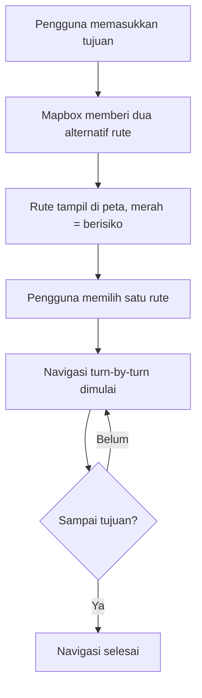
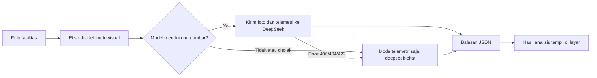
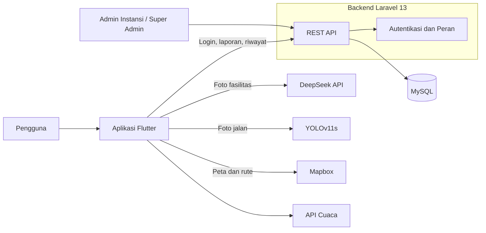
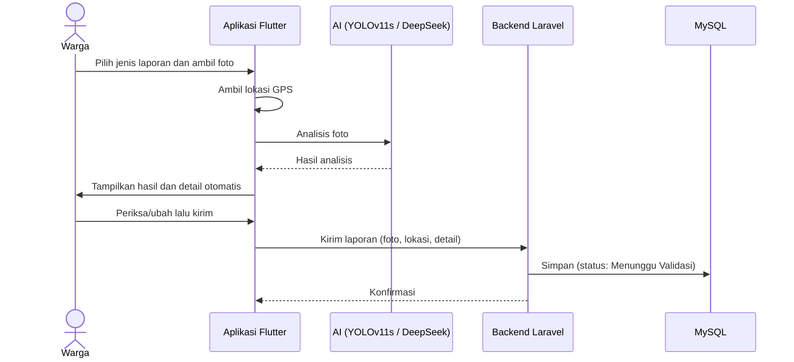
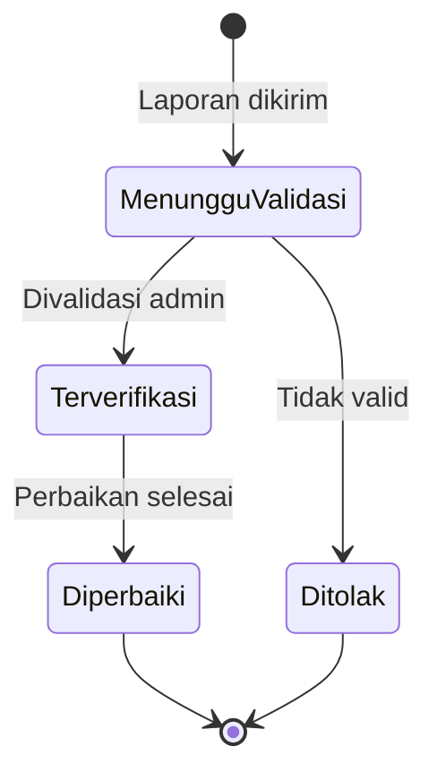
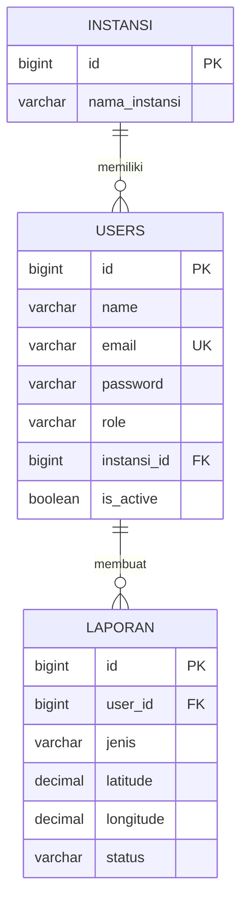

<h1 align="center">LaporDermayu</h1>

<p align="center">
  <b>Aplikasi pelaporan jalan &amp; fasilitas rusak berbasis AI, dilengkapi navigasi rute aman untuk Kabupaten Indramayu</b><br>
  <i>Laporkan kerusakannya, Kawal perbaikannya!</i>
</p>

<p align="center">
  
</p>

<p align="center">
  
  
  
</p>

<p align="center">
  
  
  
  
  
  
</p>

---

## 📑 Daftar Isi

- [Tentang Proyek](#-tentang-proyek)
- [Latar Belakang](#-latar-belakang)
- [Masalah & Solusi](#-masalah--solusi)
- [Tim](#-tim)
- [Fitur Utama](#-fitur-utama)
- [Cara Kerja Navigasi Rute Aman](#-cara-kerja-navigasi-rute-aman)
- [Cara Kerja Analisis AI](#-cara-kerja-analisis-ai)
- [Teknologi](#-teknologi)
- [Arsitektur Sistem](#-arsitektur-sistem)
- [Alur Data](#-alur-data)
- [Peran Pengguna](#-peran-pengguna-rbac)
- [Struktur Database](#-struktur-database)
- [Instalasi & Menjalankan](#-instalasi-konfigurasi--menjalankan-aplikasi)
- [Akun Demonstrasi](#-akun-demonstrasi)
- [Dokumentasi Penggunaan AI](#-dokumentasi-penggunaan-ai)
- [Etika, Privasi & Keamanan](#-etika-privasi--keamanan)
- [Nilai Tambah & Dampak](#-nilai-tambah--dampak)
- [Kesesuaian dengan Kriteria Penilaian](#-kesesuaian-dengan-kriteria-penilaian)
- [Atribusi](#-atribusi-pihak-ketiga)
- [Tautan Submission](#-tautan-submission)

---

## 🌟 Tentang Proyek

**LaporDermayu** menghubungkan warga Indramayu dengan layanan publik. Warga memotret jalan atau fasilitas yang rusak, AI membantu menganalisis foto, dan laporan tercatat lengkap dengan lokasi serta bukti. Status laporan bisa dipantau sampai selesai diperbaiki.

Aplikasi juga berfungsi seperti **navigasi turn-by-turn**: pengguna memilih satu dari dua rute, lalu dipandu sampai tujuan. Rute yang berisiko ditandai **merah**.

Tujuan utamanya: **membuat jalan di Indramayu lebih aman, terutama bagi pengendara yang melintas malam hari.**

---

## 📖 Latar Belakang

Jalan adalah urat nadi aktivitas warga Indramayu: berangkat kerja, sekolah, mengangkut hasil pertanian, sampai pulang larut malam. Kondisi di lapangan sering tidak aman:

- **Jalan berlubang di banyak ruas.** Lubang sulit terlihat saat hujan (tergenang) atau malam hari, sehingga pengendara mudah terjatuh.
- **Jalan gelap tanpa penerangan memadai.** Selain menyulitkan melihat lubang, ruas yang gelap menimbulkan rasa tidak aman bagi pengendara yang pulang malam.
- **Fasilitas umum rusak.** Lampu penerangan jalan yang mati, rambu rusak, dan fasilitas lain memperburuk kondisi tersebut, dan sering baru ditangani lama setelah rusak.
- **Tidak ada kanal yang mudah** untuk melapor dan melacak tindak lanjut, serta **tidak ada informasi** untuk memilih jalan yang lebih aman sebelum berangkat.

> Selama ini warga hanya bisa "berhati-hati". **LaporDermayu mengubahnya menjadi aksi:** melapor dengan mudah, dibantu AI, dan dipandu rute yang lebih aman.

**Pertanyaan yang dijawab LaporDermayu:**

1. Bagaimana warga melaporkan jalan atau fasilitas rusak dengan cepat dan disertai bukti yang jelas?
2. Bagaimana warga memantau apakah laporannya benar-benar ditindaklanjuti?
3. Bagaimana pengendara memilih rute yang lebih aman, terutama saat malam hari?

---

## 🔎 Masalah & Solusi

| # | Masalah | Solusi LaporDermayu |
|---|---|---|
| 1 | Jalan berlubang sulit dilihat (hujan/malam), memicu kecelakaan | Deteksi kerusakan jalan dengan AI dari foto, titik tampil di peta, navigasi menandai rute berisiko |
| 2 | Jalan gelap dan lampu penerangan mati | Laporan fasilitas penerangan dianalisis AI (DeepSeek) dan dilaporkan ke instansi |
| 3 | Kanal pelaporan tidak mudah dan tidak terstruktur | Lapor dalam beberapa ketukan: foto → analisis AI → kirim |
| 4 | Laporan tanpa bukti, lokasi, dan tingkat kerusakan | Foto, GPS otomatis, tingkat keparahan dari AI, detail laporan terisi otomatis |
| 5 | Warga tidak bisa melacak tindak lanjut | Status laporan, riwayat, dan ringkasan *Dampak Nyata* |

### 🎯 Target Pengguna

- **Masyarakat Indramayu** yang ingin melapor dan memilih rute aman
- **Pengendara** yang sering melintas malam hari
- **Admin Instansi (Pemda Indramayu)** yang memverifikasi dan menindaklanjuti laporan

---

## 👥 Tim

| Peran | Nama | GitHub |
|---|---|---|
| Ketua Tim | `[ISI]` | [`@[ISI]`](https://github.com/[ISI]) |
| Anggota | `[ISI]` | [`@[ISI]`](https://github.com/[ISI]) |
| Anggota | `[ISI, hapus baris jika tidak ada]` | [`@[ISI]`](https://github.com/[ISI]) |
| Anggota | `[ISI, hapus baris jika tidak ada]` | [`@[ISI]`](https://github.com/[ISI]) |

**Nama tim:** `[ISI]` · **Instansi:** `[ISI]`

> Seluruh commit dibuat dari akun GitHub anggota yang terdaftar di LOGICODIX 2026.

---

## ✨ Fitur Utama

### 📸 Pelaporan Berbantuan AI

| Fitur | Deskripsi |
|---|---|
| **Lapor Jalan Rusak** | Foto jalan dianalisis untuk mendeteksi lubang, tambalan, dan kerusakan lain, lengkap dengan bounding box dan persentase keyakinan. Model: **YOLOv11s** `[ISI: jelaskan juga peran DeepSeek untuk jalan rusak, atau hapus jika tidak dipakai]` |
| **Lapor Fasilitas Umum** | Foto Lampu PJU, rambu, traffic light, halte, marka, atau guardrail dianalisis **DeepSeek** menjadi jenis fasilitas, kondisi, tingkat keparahan, deskripsi, dan saran tindak lanjut. |
| **Detail Laporan Otomatis** | Judul dan deskripsi terisi dari hasil AI dan tetap bisa diedit sebelum dikirim. |
| **Lokasi Otomatis** | Koordinat GPS dilampirkan ke setiap laporan. |

### 🧭 Navigasi Rute Aman

| Fitur | Deskripsi |
|---|---|
| **Dua Pilihan Rute** | Pengguna melihat dua rute alternatif. Rute berisiko ditandai **merah** `[ISI: arti warna lain, mis. hijau/biru = lebih aman]`. |
| **Navigasi Turn-by-Turn** | Pengguna dipandu langkah demi langkah menuju tujuan. |
| **Rute Terkunci** | Setelah memilih satu rute, navigasi berjalan pada rute tersebut sampai selesai. Tidak berpindah ke rute lain di tengah perjalanan. |
| **Peta Mapbox** | Peta interaktif dengan pencarian tujuan dan lokasi pengguna. |
| **Info Cuaca & Peringatan** | Suhu, kondisi cuaca, kelembapan, angin, dan peringatan seperti genangan atau jalan licin. |

### 📊 Pemantauan & Pengelolaan

| Fitur | Deskripsi |
|---|---|
| **Dampak Nyata** | Jumlah laporan: dikirim, terverifikasi, diperbaiki. |
| **Laporan Terkini & Riwayat** | Status laporan, misalnya *Menunggu Validasi*. |
| **Akses Berbasis Peran** | Tiga peran: Masyarakat, Admin Instansi, dan Super Admin. |
| **Dashboard Pengelolaan** | `[ISI: jelaskan panel web/admin untuk memverifikasi laporan dan memperbarui status, atau hapus baris ini jika belum ada]` |

---

## 🧭 Cara Kerja Navigasi Rute Aman



- Pengguna memilih **satu rute** dan dipandu sampai tujuan.
- Setelah dipilih, rute **terkunci** sampai navigasi selesai atau dibatalkan.
- Penilaian risiko rute berdasarkan `[ISI: dasar penandaan merah, mis. titik laporan jalan rusak/gelap di sepanjang rute]`.

> **Catatan:** rute aman adalah *rekomendasi*, bukan jaminan keselamatan. Aplikasi tidak melabeli wilayah sebagai "daerah kriminal"; yang dinilai adalah kondisi fisik jalan.

---

## 🤖 Cara Kerja Analisis AI

Analisis fasilitas umum dilakukan oleh `GroqService` (alias `DeepSeekService`) di aplikasi Flutter.



**1. Telemetri visual** dihitung langsung di perangkat dari foto, lalu dikirim sebagai konteks tambahan:

| Data | Kegunaan |
|---|---|
| Waktu pengambilan (siang/malam) | Membedakan lampu padam saat malam dengan kondisi wajar di siang hari |
| Rata-rata kecerahan (luminance, 0–255) | Menilai tingkat penerangan |
| Persentase area gelap | Menilai seberapa gelap ruas jalan |
| Persentase titik cahaya kuat | Menilai apakah ada lampu yang menyala |
| Resolusi foto | Informasi teknis |

**2. Format keluaran** (JSON wajib):

| Field | Isi |
|---|---|
| `fasilitas_umum` | Apakah objek termasuk fasilitas jalan |
| `jenis_fasilitas` | Mis. Lampu Penerangan Jalan (PJU), Rambu Lalu Lintas |
| `kondisi` | `mati`, `rusak`, `roboh`, `miring`, `hilang`, `tertutup`, `normal` |
| `tingkat_keparahan` | `ringan`, `sedang`, `berat` |
| `deskripsi` | Penjelasan 1–2 kalimat berbahasa Indonesia |
| `saran` | Saran tindak lanjut untuk petugas |

**3. Aturan keparahan:** *berat* untuk bahaya langsung (traffic light mati, tiang roboh melintang, rambu tikungan tajam hilang), *sedang* untuk PJU mati di jalan utama atau rambu miring/tertutup, *ringan* untuk marka pudar atau stiker liar.

**4. Penanganan error:** kunci tidak valid (401), kuota habis (402), server sibuk (429), batas waktu 40 detik, dan fallback otomatis jika endpoint menolak gambar.

---

## 🧰 Teknologi

| Lapisan | Teknologi |
|---|---|
| **Mobile** (`/lapordermayu`) | Flutter `[ISI: versi dari flutter --version]` |
| **Backend** (`/backend`) | Laravel 13 (PHP sesuai `composer.json`) |
| **Database** | MySQL |
| **Peta & Navigasi** | Mapbox |
| **AI Fasilitas** | DeepSeek (model dari `DEEPSEEK_MODEL`, bawaan `deepseek-flash`; cadangan `deepseek-chat`) |
| **AI Jalan Rusak** | YOLOv11s `[ISI: format model, mis. .pt / .tflite]` |
| **Library Flutter** | `flutter_dotenv`, `http`, `image` `[ISI: lengkapi dari pubspec.yaml]` |
| **Cuaca** | `[ISI: sumber data cuaca]` |

---

## 🏗️ Arsitektur Sistem



> `[ISI: sesuaikan panah dengan kode, misalnya apakah analisis AI dipanggil dari Flutter atau lewat Laravel]`

---

## 🔄 Alur Data

### Alur Pelaporan



### Siklus Status Laporan



> `[ISI: samakan nama status dengan enum di database]`

---

## 🔐 Peran Pengguna (RBAC)

| Peran | Kode | Hak Akses |
|---|---|---|
| **Masyarakat** | `masyarakat` | Melapor, navigasi rute aman, memantau riwayat dan dampak |
| **Admin Instansi** | `admin_instansi` | Terkait instansi (Pemda Indramayu): memverifikasi dan menindaklanjuti laporan `[ISI]` |
| **Super Admin** | `super_admin` | Akses penuh, pengelolaan pengguna dan instansi `[ISI]` |

Akun memiliki penanda aktif/nonaktif (`is_active`).

---

## 🗄️ Struktur Database

MySQL dengan migrasi Laravel di `backend/database/migrations`.



> `[ISI: ganti tabel LAPORAN dengan nama dan kolom asli dari migrasi, tambahkan tabel lain jika ada]`

---

## 🚀 Instalasi, Konfigurasi & Menjalankan Aplikasi

### Struktur Repositori

```
LaporDermayu/
├── backend/          # Laravel 13 (REST API + MySQL)
├── lapordermayu/     # Aplikasi Flutter
├── assets/           # Gambar README
└── README.md
```

### Prasyarat

| Kebutuhan | Keterangan |
|---|---|
| Git | - |
| PHP & Composer | Versi sesuai `backend/composer.json` (Laravel 13) |
| MySQL | `[ISI: versi]` |
| Flutter SDK | Stable terbaru |
| Android Studio / emulator / perangkat Android | Untuk menjalankan aplikasi |
| Akun DeepSeek (API key) | https://platform.deepseek.com |
| Akun Mapbox (access token) | https://account.mapbox.com |

### 1) Clone

```bash
git clone https://github.com/faldyardiansyah/LaporDermayu.git
cd LaporDermayu
```

### 2) Backend (Laravel 13)

```bash
cd backend
composer install
cp .env.example .env
php artisan key:generate
```

Buat database MySQL kosong, lalu isi koneksi di `backend/.env`:

```dotenv
DB_CONNECTION=mysql
DB_HOST=127.0.0.1
DB_PORT=3306
DB_DATABASE=nama_database
DB_USERNAME=root
DB_PASSWORD=
```

Jalankan migrasi, seeder, dan server:

```bash
php artisan migrate
php artisan db:seed
php artisan serve --host=0.0.0.0 --port=8000
```

> ⚠️ `DatabaseSeeder` membutuhkan instansi **"Pemda Indramayu"** sudah ada di tabel `instansi`. Jika belum ada, seeder dibatalkan tanpa mengubah data. `[ISI: jelaskan instansi itu dibuat oleh migrasi atau seeder lain, dan pastikan urutan perintah di atas sudah benar]`

### 3) Aplikasi Flutter

```bash
cd lapordermayu
cp .env.example .env
flutter pub get
```

Isi `lapordermayu/.env` (nama variabel saja, **isi nilainya sendiri**):

```dotenv
DEEPSEEK_API_KEY=
DEEPSEEK_MODEL=deepseek-flash
MAPBOX_TOKEN=
API_BASE_URL=
```

| Variabel | Fungsi |
|---|---|
| `DEEPSEEK_API_KEY` | Kunci API DeepSeek untuk analisis AI |
| `DEEPSEEK_MODEL` | Nama model (bawaan: `deepseek-flash`) |
| `MAPBOX_TOKEN` | Access token Mapbox untuk peta dan navigasi |
| `API_BASE_URL` | Alamat API Laravel `[ISI: samakan dengan nama variabel di kode, mis. http://10.0.2.2:8000/api untuk emulator Android]` |

Jalankan aplikasi:

```bash
flutter run
```

> Emulator Android mengakses komputer lokal lewat `10.0.2.2`. Untuk perangkat fisik, gunakan IP komputer pada jaringan yang sama.

### 4) Build APK

```bash
flutter build apk --release
# hasil: build/app/outputs/flutter-apk/app-release.apk
```

### 🧪 Mencoba Aplikasi (untuk Juri/Penguji)

Juri **tidak perlu** membuat akun berbayar, berlangganan, atau mendaftar kunci API sendiri.

1. Unduh dan pasang APK dari bagian [Tautan Submission](#-tautan-submission).
2. Masuk memakai [Akun Demonstrasi](#-akun-demonstrasi).
3. APK sudah dikonfigurasi tim untuk terhubung ke backend dan layanan pendukung (DeepSeek, Mapbox) `[ISI: konfirmasi alamat backend yang aktif/di-deploy dan bahwa kuota API aktif selama masa penilaian]`.

Opsi lain: jalankan dari kode sumber mengikuti langkah 1–3 di atas dengan kunci milik sendiri.

### 🔒 Keamanan Kredensial

- API key dan token **tidak** ditulis di kode maupun README. Semuanya dibaca dari file `.env`.
- File `.env` masuk `.gitignore` dan tidak boleh di-push.
- Repositori menyertakan `.env.example` yang hanya berisi nama variabel.

---

## 🔑 Akun Demonstrasi

Dibuat otomatis oleh `DatabaseSeeder` (`php artisan db:seed`):

| Peran | Email | Password |
|---|---|---|
| Super Admin | `superadmin@gmail.com` | `12345678` |
| Admin Instansi (Pemda Indramayu) | `instansi@gmail.com` | `12345678` |
| Masyarakat | `user@gmail.com` | `12345678` |

---

## 🤖 Dokumentasi Penggunaan AI

### AI sebagai fitur produk

| Model | Bagian produk | Tugas | Masukan → Keluaran |
|---|---|---|---|
| **DeepSeek** (`deepseek-flash`, cadangan `deepseek-chat`) | Lapor Fasilitas Umum | Mengenali jenis dan kondisi fasilitas, menilai keparahan, menyusun deskripsi dan saran | Foto + telemetri visual → JSON (jenis, kondisi, keparahan, deskripsi, saran) |
| **YOLOv11s** | Lapor Jalan Rusak | Mendeteksi kerusakan jalan | Foto → bounding box, label, confidence |
| **DeepSeek** | Lapor Jalan Rusak `[ISI: jika dipakai, jika tidak hapus baris ini]` | `[ISI]` | `[ISI]` |

**Sumber/pelatihan YOLOv11s:** `[ISI: dataset dan cara latih, atau model pre-trained yang dipakai]`
**Metrik:** `[ISI: mAP / precision / recall jika ada]`

### AI sebagai alat bantu pengembangan

| Alat | Kegunaan |
|---|---|
| `[ISI: mis. Claude / ChatGPT / Copilot, hapus jika tidak dipakai]` | `[ISI: mis. debugging, dokumentasi]` |

### Tanggung jawab

- Tim bertanggung jawab penuh atas kode, keamanan, dan fungsi aplikasi, termasuk kode hasil AI.
- Hasil AI adalah bantuan: pengguna dapat memeriksa dan mengubahnya sebelum laporan dikirim.
- Jika layanan AI tidak tersedia, aplikasi menampilkan pesan kesalahan yang jelas, dan analisis fasilitas dapat beralih ke mode telemetri.

---

## 🔐 Etika, Privasi & Keamanan

| Aspek | Penerapan |
|---|---|
| **Kredensial** | Dibaca dari `.env`, tidak ada key di repositori, `.env.example` tanpa nilai asli |
| **Autentikasi & peran** | Password di-hash (`Hash::make`), akses dibagi per peran, akun bisa dinonaktifkan |
| **Privasi foto** | `[ISI: mis. foto hanya dikirim untuk analisis, penanganan wajah/plat nomor]` |
| **Data lokasi** | Dipakai hanya untuk pelaporan dan navigasi `[ISI]` |
| **Transparansi AI** | Model, bagian produk, dan batasannya dijelaskan di README ini |
| **Tidak menstigma wilayah** | Penilaian rute hanya berdasar kondisi fisik jalan, bukan melabeli daerah atau kelompok |
| **Hasil AI dapat dikoreksi** | Pengguna bisa mengubah hasil sebelum dikirim |

---

## 🚀 Nilai Tambah & Dampak

| Aplikasi pelaporan biasa | LaporDermayu |
|---|---|
| Hanya form dan foto manual | AI membaca foto dan mengisi detail laporan otomatis |
| Hanya melapor | Dilengkapi **navigasi turn-by-turn** dengan pilihan rute dan penanda risiko |
| Satu jenis kerusakan | Jalan rusak, penerangan, dan fasilitas umum dalam satu aplikasi |
| Analisis AI hanya dari foto | AI juga memakai **telemetri visual** (waktu, kecerahan, area gelap, titik cahaya) agar akurat untuk kasus lampu padam |
| Status tidak jelas | Status laporan dan statistik *Dampak Nyata* |

**Keselarasan dengan subtema dan SDGs:**

- **Subtema Logicodix:** *Civic Tech & Community Service*, yaitu menghubungkan masyarakat dengan layanan publik dan mempermudah pelaporan masalah komunitas.
- **SDG 3:** mendukung target penurunan korban kecelakaan lalu lintas.
- **SDG 9:** infrastruktur jalan yang lebih terpantau dan terawat.
- **SDG 11:** ruang publik yang lebih aman dan inklusif.

---

## 🎯 Kesesuaian dengan Kriteria Penilaian

| Kriteria | Bobot | Bagaimana LaporDermayu memenuhinya |
|---|---|---|
| **Problem-Solution Fit** | 25% | Masalah nyata di Indramayu: jalan berlubang pemicu kecelakaan, jalan gelap yang terasa tidak aman, dan laporan yang sulit dilacak. Solusi: pelaporan berbantuan AI, pelacakan status, dan navigasi rute aman. |
| **Technology Innovation** | 25% | Dua jalur AI (YOLOv11s dan DeepSeek) dengan telemetri visual dan fallback otomatis, plus navigasi turn-by-turn berbasis Mapbox. AI menjadi nilai tambah utama. |
| **Software Engineering** | 25% | Arsitektur terpisah (Flutter + Laravel 13 + MySQL), RBAC, seeder akun demo, `.env.example`, riwayat commit berkala, dokumentasi lengkap. |
| **UI/UX** | 15% | Navigasi sederhana, alur lapor singkat, hasil AI langsung terlihat, navigasi dengan dua pilihan rute. |
| **Etika & Keamanan** | 10% | Kredensial di `.env`, password ter-hash, akses per peran, transparansi AI, tidak menstigma wilayah. |

---

## 📚 Atribusi Pihak Ketiga

| Jenis | Nama | Sumber / Lisensi | Digunakan untuk |
|---|---|---|---|
| Framework | Flutter | BSD-3-Clause | Aplikasi mobile |
| Framework | Laravel 13 | MIT | Backend |
| Basis data | MySQL | GPL-2.0 | Penyimpanan data |
| Layanan peta | Mapbox | Ketentuan Mapbox | Peta dan navigasi |
| Layanan AI | DeepSeek API | Ketentuan DeepSeek | Analisis fasilitas |
| Model | YOLOv11s / YOLO11s (Ultralytics) | AGPL-3.0 / lisensi Ultralytics | Deteksi jalan rusak |
| Library Dart | `flutter_dotenv`, `http`, `image` | Lihat pub.dev | Konfigurasi, jaringan, pengolahan foto |
| Dataset | `[ISI]` | `[ISI]` | Melatih/menguji YOLOv11s |
| Library lain | `[ISI: dari pubspec.yaml dan composer.json]` | `[ISI]` | `[ISI]` |
| Aset visual | Logo, maskot, banner LaporDermayu | `[ISI: karya tim / sumber]` | Identitas aplikasi |

---

## 🔗 Tautan Submission

| Komponen | Tautan |
|---|---|
| 📂 Repositori | https://github.com/faldyardiansyah/LaporDermayu |
| 🎬 Video Demo (3–5 menit) | `[ISI: YouTube Unlisted/Public]` |
| 📱 Berkas APK | `[ISI: tautan unduhan APK, mis. GitHub Releases]` |
| 🔖 Commit Hash Final | `[ISI: hash commit sebelum 14 November 2026, 23.59 WIB]` |

---

<p align="center">
  Dibuat untuk <b>LOGICODIX 2026</b><br>
  <i>"NextGen Digital Innovation: Crafting Creative Solutions for a Better Society"</i>
</p>
